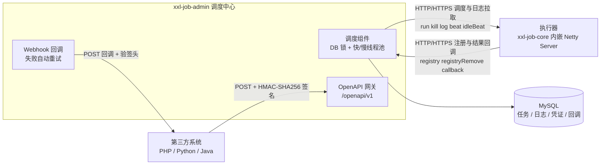

<p align="center">
  
</p>

<h1 align="center">XXL-JOB-PRO</h1>

<p align="center">
  基于 <a href="https://github.com/xuxueli/xxl-job">XXL-JOB</a> 2.5.0 构建的增强版分布式任务调度平台<br/><br/>
  &nbsp;
  &nbsp;
  &nbsp;
  &nbsp;
  
</p>

本项目继承 XXL-JOB 的全部调度能力，并针对企业内网落地的实际需求做了扩展：数据库化的用户与权限模型、面向异构系统的 OpenAPI 与 Webhook、调度中心/执行器的 HTTPS 通信、以及升级为 Vue 2 + Element UI 的后台控制台。

- 当前版本：`2.5.0`（Maven 坐标 `com.xuxueli:xxl-job-pro:2.5.0`）
- 与上游关系：功能对齐 XXL-JOB 2.5.0，再叠加下文的增强项

## 目录

- [特性](#特性)
- [模块结构](#模块结构)
- [架构概览](#架构概览)
- [快速开始](#快速开始)
- [配置说明](#配置说明)
- [开放 API](#开放-api)
- [HTTPS 支持](#https-支持)
- [生产上线检查清单](#生产上线检查清单)
- [文档索引](#文档索引)
- [技术栈](#技术栈)
- [常见问题](#常见问题)
- [许可证](#许可证)

## 特性

### 调度核心（继承自 XXL-JOB）


| 分类     | 能力                                                                                                                          |
| -------- | ----------------------------------------------------------------------------------------------------------------------------- |
| 调度模型 | 中心式调度 + 分布式执行；调度中心集群部署，通过 DB 锁保证同一时刻只触发一次                                                   |
| 执行器   | 集群部署、自动注册与手动录入、弹性扩缩容，上下线后下次调度自动重新分配                                                        |
| 触发方式 | CRON、固定速率（FIX_RATE）、API/事件触发、人工触发、父子任务触发                                                              |
| 路由策略 | 第一个、最后一个、轮询、随机、一致性 HASH、最不经常使用、最近最久未使用、故障转移、忙碌转移、分片广播                         |
| 容错策略 | 调度过期（忽略 / 立即补偿一次）、阻塞处理（单机串行 / 丢弃后续 / 覆盖之前）、超时中断、失败重试（支持分片粒度）、故障转移     |
| 任务类型 | Bean 任务、GLUE 任务（Groovy / Shell / Python / PHP / NodeJS / PowerShell，Web IDE 在线编辑并保留 30 个历史版本）、命令行任务 |
| 分片     | 分片广播 + 动态分片，按执行器维度扩展分片数量                                                                                 |
| 可观测   | Rolling 实时日志、任务进度监控、运行报表（任务数 / 调度次数 / 执行器数、日期分布图、成功比例图）                              |
| 告警     | 任务失败邮件告警，支持多地址群发与扩展接入                                                                                    |

### 本项目的增强

- **用户与权限**：用户存库（初始化 `admin / 123456`），管理员、普通用户两种角色，按执行器组维度授权，普通用户只能操作已授权的执行器组内的任务。
- **开放 API**：`/openapi/v1` 下的机器接口，`AppKey + HMAC-SHA256 签名 + 时间戳 + nonce 防重放`，与后台会话接口、执行器私有协议完全隔离；凭证在「开放API凭证」页面维护。
- **Webhook 回调**：任务触发后可回调业务方，回调请求带 `Xxl-Job-Callback-Sign` 验签头；失败按退避策略最多重试 5 次，集群下以 `next_retry_time` 乐观认领避免重复投递。
- **HTTPS**：调度中心与执行器均可开启 HTTPS（JKS / PKCS12 证书），配置见 [doc/https-support.md](doc/https-support.md)。
- **后台升级**：页面由 FreeMarker 模板页升级为 Vue 2（2.6.14）+ Element UI 组件化实现，初始化数据统一走 REST 接口（如 `/dashboard/initData`）。
- **国际化**：`zh_CN` / `zh_TC` / `en` 三种语言，配置项 `xxl.job.i18n`。
- **配置格式**：`application.properties` 已迁移为 `application.yml`，键名与原有拼写保持 1:1。

## 模块结构


| 模块                                 | 说明                                                                        |
| ------------------------------------ | --------------------------------------------------------------------------- |
| `xxl-job-core`                       | 执行器 SDK 与通信内核（Netty + Gson），业务工程依赖此包                     |
| `xxl-job-admin`                      | 调度中心：任务管理、调度触发、日志、用户与权限、开放 API 网关、Webhook 回调 |
| `xxl-job-executor-sample-springboot` | Spring Boot 执行器示例，演示 `@XxlJob` 任务写法                              |

```
xxl-job-pro
├── doc/                      文档、架构图、建表脚本
│   ├── db/tables_xxl_job.sql 建表 + 初始化数据（10 张表）
│   ├── openapi-integration.md
│   ├── https-support.md
│   └── XXL-JOB官方文档.md
├── xxl-job-core/
├── xxl-job-admin/
└── xxl-job-executor-sample-springboot/
```

## 架构概览



- 调度中心 ↔ 执行器：私有协议 `/api`，双向请求均校验 `accessToken`；调度中心主动下发 `run/kill/log/beat/idleBeat`，执行器上报 `registry/registryRemove/callback`。
- 第三方 ↔ 调度中心：`/openapi/v1/**` 机器接口，签名鉴权，与后台会话、`/api` 私有协议完全隔离。
- 调度中心 → 业务方：Webhook 回调，携带 `Xxl-Job-Callback-Sign`。
- 调度一致性全部依赖 MySQL（表锁 + 任务/日志/凭证存储），无额外中间件依赖。

## 快速开始

### 环境要求

- JDK 8 及以上（编译目标 1.8）
- Maven 3.6+
- MySQL 8.0（驱动为 MySQL Connector/J 9.1.0；如仍使用 5.7，请自行回退到 8.x 驱动）

### 1. 初始化数据库

```bash
mysql -uroot -p -e "CREATE DATABASE IF NOT EXISTS xxl_job DEFAULT CHARACTER SET utf8mb4;"
mysql -uroot -p xxl_job < doc/db/tables_xxl_job.sql
```

脚本会创建 10 张业务表并写入初始数据：

- 后台账号：`admin / 123456`（表中以 MD5 存储）
- 示例 OpenAPI 凭证：`demo_app_key / demo_app_secret_please_change_me`（**生产环境请立即删除或修改**）

### 2. 修改配置

编辑 `xxl-job-admin/src/main/resources/application.yml`，至少确认数据库连接与 `accessToken`：

```yaml
server:
  port: 8081                                  # 调度中心端口
  servlet:
    context-path: /xxl-job-admin              # 上下文路径，OpenAPI 前缀随之变化

spring:
  datasource:
    url: jdbc:mysql://127.0.0.1:3306/xxl_job?useUnicode=true&characterEncoding=UTF-8&autoReconnect=true&serverTimezone=Asia/Shanghai
    username: root
    password: 12345678

xxl:
  job:
    accessToken: default_token                # 调度中心与执行器必须一致，生产请更换
```

### 3. 编译打包

```bash
mvn clean package
```

产物：`xxl-job-admin/target/xxl-job-admin-2.5.0.jar`（同时生成 `-sources` 与 `-javadoc` 包）。
根 `pom.xml` 默认 `maven.test.skip=true`，需要跑测试时用 `-Dmaven.test.skip=false` 覆盖。

### 4. 启动调度中心

```bash
# 默认端口 8081
java -jar xxl-job-admin/target/xxl-job-admin-2.5.0.jar

# 指定端口
java -jar xxl-job-admin/target/xxl-job-admin-2.5.0.jar --server.port=8091
```

也可以直接用 IDE 运行 `com.xxl.job.admin.XxlJobAdminApplication`。

### 5. 访问后台

浏览器打开 `http://127.0.0.1:8081/xxl-job-admin`，使用 `admin / 123456` 登录。

命令行快速验证服务是否就绪：

```bash
curl -s -o /dev/null -w "%{http_code}\n" http://127.0.0.1:8081/xxl-job-admin/toLogin   # 期望 200
```

左侧菜单包含：运行报表、任务管理、调度日志、执行器管理、用户管理、开放API凭证、使用教程。
其中「使用教程」是内置的 OpenAPI 文档页，含接口清单、字段说明、Webhook 规范与在线签名调试器。

### 6. 接入执行器

先启动示例执行器：

```bash
java -jar xxl-job-executor-sample-springboot/target/xxl-job-executor-sample-springboot-2.5.0.jar
```

- 执行器 AppName：`xxl-job-executor-boot`，端口 `9999`
- 示例配置中的调度中心地址是 `http://127.0.0.1:8080/xxl-job-admin`，而调度中心 yml 默认为 **8081**，两者不一致时请修改 `xxl-job-executor-sample-springboot/src/main/resources/application.properties` 中的 `xxl.job.admin.addresses`
- 启动后到「执行器管理」确认已自动注册

业务工程接入时，先把核心包安装到本地仓库，再引入依赖：

```bash
mvn clean install
```

```xml
<dependency>
    <groupId>com.xuxueli</groupId>
    <artifactId>xxl-job-core</artifactId>
    <version>2.5.0</version>
</dependency>
```

## 配置说明

`xxl-job-admin/src/main/resources/application.yml` 中的关键配置：


| 配置项                                      | 默认值                   | 说明                                                                            |
| ------------------------------------------- | ------------------------ | ------------------------------------------------------------------------------- |
| `server.port`                               | `8081`                   | 调度中心端口                                                                    |
| `server.servlet.context-path`               | `/xxl-job-admin`         | 上下文路径                                                                      |
| `spring.datasource.*`                       | `127.0.0.1:3306/xxl_job` | 数据源，连接池 HikariCP                                                         |
| `spring.mail.*`                             | 示例 SMTP                | 失败告警邮件，未启用可留空；`management.health.mail.enabled` 已关闭邮件健康检查 |
| `xxl.job.accessToken`                       | `default_token`          | 调度中心与执行器通信令牌，生产必须修改                                          |
| `xxl.job.i18n`                              | `zh_CN`                  | 可选 `zh_CN` / `zh_TC` / `en`                                                    |
| `xxl.job.timeout`                           | `3`                      | 调度请求超时（秒）                                                              |
| `xxl.job.logretentiondays`                  | `30`                     | 调度日志保留天数                                                                |
| `xxl.job.triggerpool.fast.max` / `slow.max` | `200` / `100`            | 快、慢任务线程池上限                                                            |
| `xxl.job.openapi.timestamp.window`          | `300000`                 | OpenAPI 时间戳有效窗口（毫秒），用于防重放                                      |
| `xxl.job.admin.enableHttps` 等              | `false`                  | 调度中心 HTTPS 开关与证书配置                                                   |

## 开放 API

面向第三方系统 / 异构项目的机器接口：远程创建、更新、启停、删除任务，触发执行并回查结果。

- 前缀：`{context-path}/openapi/v1`，全部为 `POST`，`Content-Type: application/json;charset=UTF-8`
- 鉴权头：`XXL-JOB-APP-KEY`、`XXL-JOB-TIMESTAMP`、`XXL-JOB-NONCE`、`XXL-JOB-SIGN`
- 签名算法：

```
stringToSign = appKey + "\n" + timestamp + "\n" + nonce + "\n" + rawBody
sign         = lowercaseHex( HmacSHA256( appSecret, stringToSign ) )
```

`rawBody` 必须与实际发送的字节完全一致；无请求体的端点取空串。


| 端点                       | 说明                                |
| -------------------------- | ----------------------------------- |
| `/job/add`                 | 新建任务，返回任务 ID               |
| `/job/update`              | 更新任务                            |
| `/job/start` / `/job/stop` | 启动 / 停止任务（`?id=`）           |
| `/job/remove`              | 删除任务（`?id=`）                  |
| `/job/get`                 | 查询任务详情（`?id=`）              |
| `/job/trigger`             | 触发一次执行，返回调度日志 ID       |
| `/joblog/result`           | 按日志 ID 回查执行结果（`?logId=`） |

### Java SDK

集成方只需依赖 `xxl-job-core`，签名、时间戳、nonce 全由 SDK 处理：

```java
OpenApiClient client = new OpenApiClient(
        "http://127.0.0.1:8081/xxl-job-admin", "your_app_key", "your_app_secret");

Map<String, Object> job = new LinkedHashMap<>();
job.put("jobGroup", 1);
job.put("jobDesc", "示例任务");
job.put("author", "ops");
job.put("scheduleType", "CRON");
job.put("scheduleConf", "0 0/5 * * * ?");
job.put("glueType", "BEAN");
job.put("executorHandler", "demoJobHandler");

int jobId  = Integer.parseInt(client.addJob(job).getContentAsString());   // content = 新任务 ID
client.startJob(jobId);
long logId = Long.parseLong(client.trigger(jobId, "param", null).getContentAsString());
OpenApiResult result = client.queryResult(logId);                         // content = 执行结果
```

| SDK 方法 | 对应端点 |
| --- | --- |
| `addJob(Map)` / `updateJob(Map)` | `/job/add`、`/job/update` |
| `startJob(int)` / `stopJob(int)` / `removeJob(int)` / `getJob(int)` | `/job/start`、`/job/stop`、`/job/remove`、`/job/get` |
| `trigger(int, String, String)` | `/job/trigger` |
| `trigger(int, String, String, String)` | `/job/trigger`，第 4 个参数为本次回调地址 |
| `queryResult(long)` | `/joblog/result` |

`OpenApiResult` 提供 `code` / `msg` / `content` / `isSuccess()` / `getContentAsString()`。
完整可运行示例：`xxl-job-executor-sample-springboot` 的 `com.xxl.job.executor.openapi.OpenApiClientDemo`。

完整字段说明、请求/响应示例、错误码与 Webhook 规范见 [doc/openapi-integration.md](doc/openapi-integration.md)，或登录后在「使用教程」页查看（可在页面上直接生成签名头与 cURL）。

## HTTPS 支持

调度中心开启 HTTPS（`application.yml`）：

```yaml
xxl:
  job:
    admin:
      enableHttps: true
      keyStorePath: /opt/certs/xxl-job.jks   # 支持 classpath 与文件系统路径
      keyStorePassword: your-password
      keyStoreType: JKS                       # JKS / PKCS12
      keyAlias: xxl-job                       # 可选
```

执行器开启 HTTPS（`application.properties`）：

```properties
xxl.job.executor.enableHttps=true
xxl.job.executor.keyStorePath=/opt/certs/executor.jks
xxl.job.executor.keyStorePassword=your-password
xxl.job.executor.keyStoreType=JKS
xxl.job.executor.keyAlias=executor
```

证书生成、信任库配置与常见问题见 [doc/https-support.md](doc/https-support.md)，特性变更记录见 [doc/changelog-https-support.md](doc/changelog-https-support.md)。

## 生产上线检查清单

| 检查项 | 说明 |
| --- | --- |
| 通信令牌 | 更换 `xxl.job.accessToken` 默认值，调度中心与所有执行器保持一致 |
| 初始账号 | 修改 `admin / 123456` 默认口令（后台「用户管理」） |
| 示例凭证 | 删除或改写建表脚本内置的 `demo_app_key`；AppSecret 仅创建时明文可见，请当场保存 |
| 告警邮件 | 配置可用的 SMTP，否则任务失败不会发出告警；未启用时保持 `management.health.mail.enabled: false` |
| 时钟同步 | OpenAPI 依赖时间戳窗口与 nonce 防重放；多节点部署需 NTP 对时，nonce 缓存为单机内存、跨节点不共享 |
| 传输加密 | 跨机房或对外暴露时启用 HTTPS（见[上一节](#https-支持)） |
| 日志容量 | 按磁盘情况调整 `xxl.job.logretentiondays`（默认 30 天） |
| 数据库权限 | 使用最小权限账号；调度中心依赖 DB 锁，需允许对 `xxl_job_lock` 加行锁 |
| 高可用 | 调度中心可多实例部署（DB 锁保证一次调度只触发一次），执行器按 AppName 集群注册 |

## 文档索引

| 文档 | 内容 |
| --- | --- |
| [doc/XXL-JOB官方文档.md](doc/XXL-JOB官方文档.md) | 上游完整文档：架构、调度机制、GLUE、分片、执行器配置等 |
| [doc/XXL-JOB-English-Documentation.md](doc/XXL-JOB-English-Documentation.md) | 上游英文文档 |
| [doc/openapi-integration.md](doc/openapi-integration.md) | OpenAPI 对接指南：凭证、签名、端点、字段、Webhook、Python 示例 |
| [doc/https-support.md](doc/https-support.md) | HTTPS 配置与证书指南 |
| [doc/changelog-https-support.md](doc/changelog-https-support.md) | HTTPS 特性变更记录 |
| [doc/db/tables_xxl_job.sql](doc/db/tables_xxl_job.sql) | 建表脚本与初始化数据 |
| `doc/images/`、`doc/XXL-JOB架构图.key` | 架构图与界面素材 |

## 技术栈


| 层         | 技术                                                                             |
| ---------- | -------------------------------------------------------------------------------- |
| 调度中心   | Spring Boot 2.7.18、MyBatis 2.3.2、HikariCP、MySQL Connector/J 9.1.0、FreeMarker |
| 前端       | Vue 2.6.14、Element UI、ECharts、AdminLTE 外壳                                   |
| 执行器内核 | Netty 4.1、Gson 2.11、Groovy 4.0（GLUE）                                         |
| 构建       | Maven，编译目标 JDK 1.8，编码 UTF-8                                              |

## 常见问题

**启动报数据库连接失败或表不存在？**
确认已导入 `doc/db/tables_xxl_job.sql`，并检查 `application.yml` 中的库名与账号密码；MySQL 8 需保留 `serverTimezone=Asia/Shanghai`。

**执行器注册不上？**
依次检查：`xxl.job.admin.addresses` 是否与调度中心实际地址一致（示例执行器默认 8080，调度中心 yml 默认 8081）、两侧 `accessToken` 是否一致、执行器到调度中心的网络是否可达。

**登录失败？**
初始账号为 `admin / 123456`，密码以 MD5 存于 `xxl_job_user` 表。旧库升级时需补建 `xxl_job_api_client`、`xxl_job_openapi_callback` 两张表。

**OpenAPI 返回 401？**
按响应 `msg` 定位：凭证不存在/已停用、时间戳超出窗口（默认 5 分钟）、`nonce` 重复、签名不匹配（多因 `rawBody` 与实际发送内容不一致）。

**非 Java 系统怎么接入？**
OpenAPI 是纯 HTTP + JSON，只需按签名算法生成 4 个请求头；[doc/openapi-integration.md](doc/openapi-integration.md) 第 8 节提供 Python 完整示例，登录后台「使用教程」页还可在线生成签名头与 cURL。

**端口被占用？**
用 `--server.port=xxxx` 覆盖，同时更新执行器的 `xxl.job.admin.addresses`。

## 许可证

本项目基于 [GNU General Public License v3.0](LICENSE) 开源，上游 XXL-JOB 版权归其作者 [xuxueli](https://github.com/xuxueli) 所有。

- 本项目仓库：[https://gitee.com/chongkelai/xxl-job-pro](https://gitee.com/chongkelai/xxl-job-pro)
